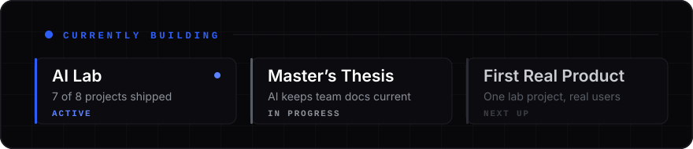
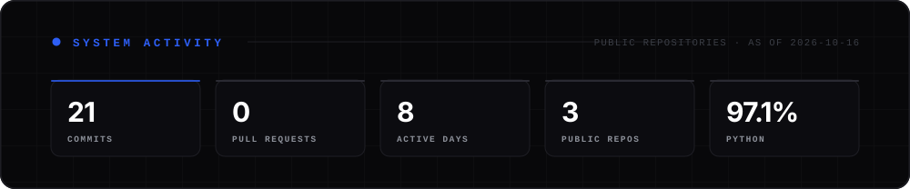

  

 

[`ABOUT`](#about) · [`AI LAB`](#lab) · [`THESIS`](#thesis) · [`BUILD LOG`](#log) · [`ACTIVITY`](#activity) · [`CONNECT`](#connect)

 

  

 

<h2 id="about"></h2>

I'm Hardik, based in Stuttgart, Germany, and I'm working my way into AI engineering the most direct way I know: **by shipping**.

Every couple of weeks I build one small AI tool that solves a real problem, for job seekers, students, or anyone facing German paperwork. Then I write down exactly how it works. Most of them run on local models through Ollama, so they're free to use and run on your own machine. My Master's thesis designs **Steward**, a multi-agent system that keeps a team's knowledge up to date, with a human approving every change.

<table>
<tr>
<td width="25%" valign="top">

`01` **Useful**

Solves a real problem for real people, not a demo for its own sake.

</td>
<td width="25%" valign="top">

`02` **Small**

One working tool, not a half-finished platform.

</td>
<td width="25%" valign="top">

`03` **Explained**

Every README covers what it does, how to run it and what I learned.

</td>
<td width="25%" valign="top">

`04` **Tested**

Automated checks, not "it worked on my laptop once".

</td>
</tr>
</table>

<h2 id="lab"></h2>

| | Project | What it does | Status |
|:--:|:--|:--|:--:|
| `01` | [**Job Application Tracker**](https://github.com/KathiriyaHardik/ai-lab/tree/main/projects/01-ai-job-tracker) | Excel / Google Sheets job-search CRM with follow-ups, pipeline analytics and a live dashboard | ✅ Live |
| `02` | [**Job-Fit Checker**](https://github.com/KathiriyaHardik/ai-lab/tree/main/projects/02-job-fit-checker) | Compares a job ad with your CV: match %, missing skills and a "Why me?" sentence | ✅ Live |
| `03` | [**Chat with Your Notes**](https://github.com/KathiriyaHardik/ai-lab/tree/main/projects/03-chat-with-notes) | Answers questions from your lecture PDFs with checked quotes and page numbers, and says so when your notes don't cover it | ✅ Live |
| `04` | [**German Letter Explainer**](https://github.com/KathiriyaHardik/ai-lab/tree/main/projects/04-letter-explainer) | Reads a photo of an official German letter: what it says, what to do, every deadline and amount | ✅ Live |
| `05` | [**Cover Letter Agent**](https://github.com/KathiriyaHardik/ai-lab/tree/main/projects/05-cover-letter-agent) | Plans, writes, checks and fixes cover letters in English and German, and waits for your OK at every step | ✅ Live |
| `06` | [**Second-Brain Agent**](https://github.com/KathiriyaHardik/ai-lab/tree/main/projects/06-second-brain) | Searches your notes by meaning, answers from them and finds connections you haven't linked yet. Works with Obsidian | ✅ Live |
| `07` | [**Company Research Agent**](https://github.com/KathiriyaHardik/ai-lab/tree/main/projects/07-company-research) | A team of AI agents reads a company's website, fact-checks what it finds and drafts a note you approve | ✅ Live |
| `08` | **First Real Product** | The most-used project, turned into a small web app that real people use | 🔜 Next |

📂 Each project folder has its own README covering what it does, how to run it and what I learned building it.

<h2 id="thesis"></h2>

**Intelligent Knowledge Management in Collaborative Environments** 
Master's thesis · Oct 2026 → Apr 2027

> **Research question:** How can Agentic AI support human-in-the-loop knowledge management to maintain accurate, context-aware, and continuously evolving knowledge in collaborative environments?

In teams, decisions are made in chat and tickets, while the documents that people and AI chatbots read slowly go out of date. My thesis designs **Steward**, a multi-agent system that spots outdated knowledge and suggests the update, *like a pull request, but for team knowledge*. A human approves every change before it is saved.

<h2 id="log"></h2>

What actually landed, grouped by day, most recent first. Generated from commit history by a GitHub Action rather than written by hand, so it cannot quietly drift out of date the way a changelog does.

<!-- BUILD-LOG:START -->

| Day | What shipped | Commits |
|:--|:--|--:|
| `2026-10-21` [`KathiriyaHardik`](https://github.com/KathiriyaHardik/KathiriyaHardik) [`ai-lab`](https://github.com/KathiriyaHardik/ai-lab) | Drop "Future" from the AI Engineer title Tidy the lab intro Rebuild the profile around AI Lab and the thesis | `3` |
| `2026-10-16` [`ai-lab`](https://github.com/KathiriyaHardik/ai-lab) | Add Company Research Agent (project 07) and mark it live in the roadmap Add Second-Brain Agent (project 06) and mark it live in the roadmap | `2` |
| `2026-10-14` [`ai-lab`](https://github.com/KathiriyaHardik/ai-lab) | Add Cover Letter Agent (project 05) and mark it live in the roadmap | `1` |
| `2026-10-12` [`ai-lab`](https://github.com/KathiriyaHardik/ai-lab) | Add German Letter Explainer (project 04) and mark it live in the roadmap Add Chat with Your Notes (project 03) and mark it live in the roadmap | `2` |
| `2026-10-09` [`ai-lab`](https://github.com/KathiriyaHardik/ai-lab) | Add Job-Fit Checker (project 02) and mark it live in the roadmap | `1` |
| `2026-10-07` [`ai-lab`](https://github.com/KathiriyaHardik/ai-lab) | Keep banner content visible when SVG animation doesn't run Rebrand repo as Hardik's AI Lab with an 8-project roadmap | `2` |

Last 6 days of work &#183; 11 commits &#183; merges excluded &#183; regenerated daily by GitHub Actions, never hand-written.
<!-- BUILD-LOG:END -->

<h2 id="activity"></h2>

 

 

 

<picture>
  <source media="(prefers-color-scheme: dark)" srcset="https://raw.githubusercontent.com/KathiriyaHardik/KathiriyaHardik/output/snake-dark.svg" />
  
</picture>

Regenerated every 12 hours by GitHub Actions from the live contribution graph.

<h2 id="connect"></h2>

Based in Stuttgart, Germany. Happy to talk about **AI engineering**, **agentic AI and knowledge management**, or building AI tools in public, especially with anyone else making the same move into AI engineering.

 &nbsp; 

 

### Building in public, one AI project at a time.

`AI Engineering` &nbsp;·&nbsp; `Agents` &nbsp;·&nbsp; `RAG`

Problem → Build → Test → Explain → Share Nothing on this page is claimed before it ships.

 

